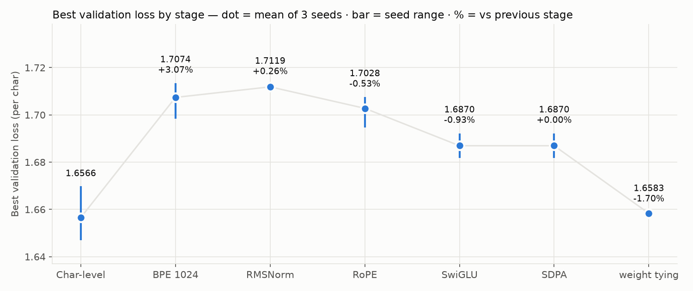

# LLM_Study_Project

📎 [Notion 정리](https://app.notion.com/p/4057b7516d7c8195a09ce823f73397ab)

> 토크나이저부터 학습 루프까지 밑바닥 구현 · 한국어 대화 모델(파라미터 500만) 공부 기록

GPT-2식 구조에서 출발 · 요즘 LLM 부품(RMSNorm · RoPE · SwiGLU · SDPA · weight tying) 한 번에 하나씩 교체 · 교체마다 시드 3개로 비교. [guppylm](https://github.com/arman-bd/guppylm) 참고



```
배고파        → 맛있게 드세요.
안녕하세요    → 잘 지내고 있는 거예요.
날씨 좋아     → 친구들이 좋아할 거예요.
면허 따는 중  → 아무래도 그렇게 만들어요.
```
고정 시험 질문 9개 중 넷 · 온도 0.5 · 시드 0 — 위 둘은 학습 데이터의 질문 · 아래 둘은 학습에 없는 말

## 교체 실험

| 모델 | 파라미터 | 검증 최저 (글자당 · 낮을수록 좋음) | 바로 앞 대비 | 그래프 |
|---|---|---|---|---|
| 글자 단위 | 5,410,012 | 1.6566 | — | |
| BPE 1024 | 5,297,152 | 1.7074 | +3.07% | [비교](docs/images/compare-1-bpe1024.png) |
| + RMSNorm | 5,293,824 | 1.7119 | +0.26% · 시드 범위 안 | [비교](docs/images/compare-2-rmsnorm.png) |
| + RoPE | 5,261,056 | 1.7028 | -0.53% | [비교](docs/images/compare-3-rope.png) |
| + SwiGLU | 5,260,024 | 1.6870 | -0.93% | [비교](docs/images/compare-4-swiglu.png) |
| + SDPA | 5,260,024 | 1.6870 | 0.00% · 학습 312.9초 → 286.4초 | [비교](docs/images/compare-5-sdpa.png) · [속도](docs/images/speed-sdpa.png) |
| + weight tying | 4,997,880 | 1.6583 | -1.70% | [비교](docs/images/compare-6-tying.png) |

검증 최저는 시드 1 · 2 · 3 평균 — 시드 범위는 맨 위 그래프의 막대 · 글자당 = 토큰당 손실 × 토큰 수 ÷ 글자 수 · `vocab_size` 고르기는 [그래프](docs/images/vocab-size.png)

## 직접 구현 BPE vs `tokenizers`

같은 학습 글 · `vocab_size` 1024 · 바이트 기준

| | 직접 구현 | `tokenizers` |
|---|---|---|
| 글자당 토큰 | 0.7434 | 0.7434 |
| 같은 조각 | 1022 / 1024 | |
| 학습 시간 | 113.1초 | 0.40초 |

## 기술 스택

| 구분 | 기술 |
|---|---|
| Language | Python 3.13 · uv |
| Model | GPT · 6층 · 256칸 · 8헤드 · 파라미터 500만 |
| Deep learning | PyTorch 2.14 CUDA 13.0 · `nn.Linear` 등 기본 부품만 — RoPE · RMSNorm · SwiGLU · 학습 루프 직접 구현 · attention 은 직접 구현 → 내장 SDPA |
| Tokenizer | 바이트 기준 BPE 직접 구현 · `tokenizers` 는 비교용 dev 의존성 |
| Data | [songys/Chatbot_data](https://github.com/songys/Chatbot_data) — 한국어 일상 대화 11,823쌍 |
| Plot | matplotlib (dev 의존성) · 학습 로그에서 그래프 생성 |
| GPU | RTX 3060 12GB |

## 실행

전제 [uv](https://docs.astral.sh/uv/) · NVIDIA GPU (GPU 없는 PC 는 같은 설치 그대로 CPU 실행)

```bash
git clone https://github.com/minky5004/LLM_Study_Project.git && cd LLM_Study_Project
uv sync
uv run python data/make_dataset.py   # 대화 데이터 내려받기 → data/train.txt · val.txt
uv run python -m llm.bpe_vocab       # BPE 합치기 표 → checkpoints/ · 약 14분 · 첫 실행만
uv run python -m llm.train           # 5000걸음 학습 · RTX 3060 약 7분
uv run python -m llm.generate        # 확인 출력 · 시험 질문 뒤 대화 · 빈 줄로 끝
```

PyPI 의 Windows torch 는 CPU 전용 — `pyproject.toml` 에서 PyTorch 인덱스 지정 · 데이터 · 모델 · 로그는 리포 밖

## 구조

```
LLM_Study_Project/
├── data/make_dataset.py        대화 데이터 내려받기 · 섞기 · 질문 단위 학습 / 검증 분리
├── docs/images/                학습 로그에서 그린 그래프
└── llm/
    ├── config.py               모델 · 학습 설정값
    ├── char_tokenizer.py       글자 단위 토크나이저 (BPE 이전 · 비교용)
    ├── bpe.py                  바이트 기준 BPE — 먼저 자르기 · 학습 · encode · decode
    ├── bpe_vocab.py            합치기 표 생성 · vocab_size 1024 · 2048 · 4096 비교
    ├── tokenizer.py            BPE 1024 껍데기 — 글자 단위와 같은 사용법
    ├── model.py                GPT — RMSNorm · RoPE · SwiGLU · SDPA · weight tying
    ├── dataset.py              무작위 위치에서 배치 뽑기
    ├── train.py                학습 루프 · 검증 최저 저장 · 학습 로그
    ├── generate.py             생성 · 온도 · 고정 시험 질문 · 대화
    ├── compare_tokenizers.py   `tokenizers` 라이브러리와 비교
    └── plot_logs.py            학습 로그 → 그래프
```

부품 교체 하나에 커밋 하나 · 교체 전 부품은 git 기록에 · 직접 짠 attention 만 SDPA 비교용 함수로 `model.py` 에
